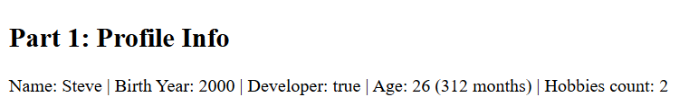
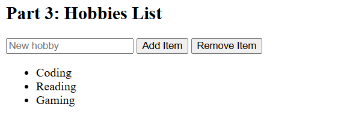

# Assignment #5: JavaScript Basics (DOM Manipulation & Events)

**Name:** Aidynuly Makhambet  
**Group:** IT-2504  
**Link:** https://aidynulymakhambet.github.io/WEB-Assignment-5/

---

## Task 1: The Personal Info Object
Created a const object named userProfile storing a string (name), a number (birthYear), a boolean (isDeveloper), and an array (hobbies).

---

## Task 2: Arithmetic Calculations
Calculated the user's current age (currentYear - birthYear), age in months (age * 12), and total hobbies count (hobbies.length), displaying the results both on the webpage and in the browser console.

---

## Task 3: HTML Form Setup
Created a simple HTML form with input fields for Username and Birth Year, along with a "Create / Update Profile" submit button.

---

## Task 4: Event Listener
Added a submit event listener to the form that captures the input values, updates userProfile.name and userProfile.birthYear, and refreshes the displayed profile data.

---

## Task 5: Creating & Removing Elements
Created an unordered list (`<ul>`) for hobbies with an "Add Item" button to append a new `<li>` element from user input and a "Remove Item" button to delete the last `<li>` item from the list.>

---

## Summary of Work Process
I built a minimal HTML and JavaScript prototype covering object creation with primitive and array data types, arithmetic age calculations, form submission event handling to update state, and DOM manipulation (createElement, appendChild, removeChild) for dynamic list management.

